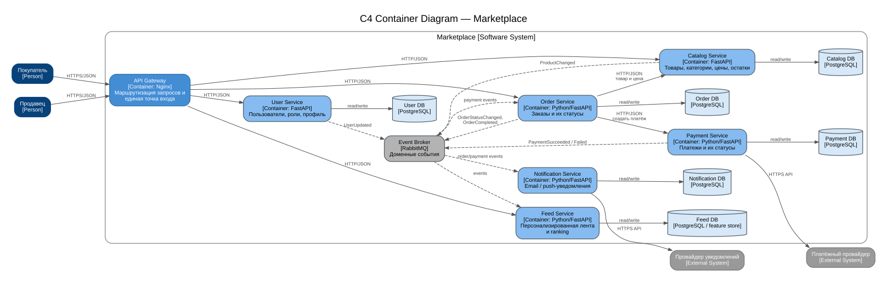

# Marketplace architecture

Учебный проект архитектуры маркетплейса. На этом этапе реализована только инициализация одного сервиса и его health-check; бизнес-логики в коде нет.

## 1. Что проектируем

Маркетплейс позволяет:

- покупателям получать персонализированную ленту товаров;
- продавцам управлять товарами каталога;
- управлять учетными записями покупателей и продавцов;
- оформлять заказы;
- создавать и учитывать платежи;
- отправлять уведомления при изменении статусов заказа и платежа.

Персонализация сделана на уровне отдельного `Feed Service`. Он хранит данные, необходимые для ранжирования, и получает события о товарах, пользователях и завершённых заказах. В выбранной версии используется простое rule-based ранжирование: учитываются интерес пользователя к категориям, популярность и свежесть товара. Просмотры и клики пользовательского интерфейса передаются в `Feed Service` через API и пополняют его собственную историю сигналов. Для нового пользователя, у которого истории ещё нет, основой выдачи служат популярность и свежесть. ML-модель в рамках этого задания не реализуется.

## 2. C4 Container diagram

Диаграмма находится в папке `architecture`:

- `container-diagram.svg` — готовая диаграмма для просмотра;
- `container-diagram.puml` — исходник PlantUML;
- `container-diagram.dot` — исходник Graphviz;
- `container-diagram.png` — PNG-версия на случай, если SVG неудобно открывать.



На диаграмме показана граница системы Marketplace, пользователи, контейнеры, принадлежащие им хранилища, внешние провайдеры и способы взаимодействия.

## 3. Домены и ответственность

| Домен | Сервис | Ответственность | Данные, которыми владеет |
|---|---|---|---|
| Users | User Service | учетные записи, роли покупателя/продавца, профиль пользователя | пользователи, роли, данные профиля |
| Catalog | Catalog Service | карточки товаров, категории, цены и доступное количество | товары, категории, цены, остатки |
| Feed | Feed Service | формирование и ранжирование персонализированной ленты | признаки пользователя, история сигналов для ранжирования, read model товаров |
| Orders | Order Service | создание заказа и изменение его статуса | заказы, позиции заказа, снимок цены на момент заказа, история статусов |
| Payments | Payment Service | создание платежа и учет результата платежной операции | платежи, внешний идентификатор операции, статус платежа |
| Notifications | Notification Service | отправка уведомлений о событиях заказа и платежа | история отправок, канал, статус доставки |

`API Gateway` не является бизнес-доменом. Это входная точка системы: она принимает клиентские HTTP-запросы и направляет их нужному сервису.

## 4. Почему домены распределены именно так

Границы сервисов совпадают с бизнес-областями, у которых есть собственные данные и причины изменяться независимо.

`Catalog Service` отделён от `Order Service`, потому что товар существует независимо от конкретного заказа. При создании заказа `Order Service` запрашивает актуальные данные товара, но сохраняет у себя снимок существенных данных заказа, например цену на момент покупки.

`Payment Service` выделен отдельно, потому что платеж имеет собственный жизненный цикл и интеграцию с внешним платежным провайдером. Заказ не хранит внутренние данные платёжного провайдера и не обращается к `Payment DB` напрямую.

`Notification Service` не включён в `Order Service`, потому что отправка сообщения — побочный эффект изменения статуса. Если внешний email/push-провайдер временно недоступен, это не должно останавливать изменение состояния заказа.

`Feed Service` выделен отдельно, так как лента имеет другой профиль нагрузки и может независимо усложняться: от простого rule-based ranking до ML-модели. При этом каталог остаётся источником истины о товаре.

## 5. Владение данными

Главное правило: **у каждого сервиса своё хранилище, общих таблиц между сервисами нет**.

Сервис может получить чужие данные только через публичный API владельца или через событие. Например:

- `Order Service` не читает `Catalog DB`, а вызывает API `Catalog Service`;
- `Notification Service` не читает `Order DB`, а получает событие `OrderStatusChanged`;
- `Feed Service` не читает базы пользователей и каталога напрямую, а обновляет свою read model по событиям.

Такой подход сохраняет границы доменов и не создаёт скрытую связанность через общую базу.

## 6. Взаимодействие сервисов

### Синхронное

Используется, когда ответ нужен для продолжения текущего пользовательского запроса.

| Откуда | Куда | Способ | Зачем |
|---|---|---|---|
| Client | API Gateway | HTTPS/JSON | работа с marketplace API |
| API Gateway | User Service | HTTP/JSON | операции с пользователем |
| API Gateway | Catalog Service | HTTP/JSON | просмотр и изменение каталога |
| API Gateway | Feed Service | HTTP/JSON | получение ленты |
| API Gateway | Order Service | HTTP/JSON | оформление и просмотр заказа |
| Order Service | Catalog Service | HTTP/JSON | проверить товар, цену и доступность |
| Order Service | Payment Service | HTTP/JSON | инициировать платёж |
| Payment Service | Payment Provider | HTTPS API | выполнить операцию у провайдера |

### Асинхронное

Для событий в целевой архитектуре используется брокер сообщений `RabbitMQ`. Сам брокер в рамках задания не поднимается.

| Событие | Кто публикует | Кто получает | Для чего |
|---|---|---|---|
| `ProductChanged` | Catalog Service | Feed Service | обновить данные товара в read model выдачи |
| `UserUpdated` | User Service | Feed Service | обновить признаки пользователя |
| `OrderCompleted` | Order Service | Feed Service | учесть покупку в персонализации |
| `PaymentSucceeded` / `PaymentFailed` | Payment Service | Order Service, Notification Service | изменить состояние заказа и сформировать уведомление |
| `OrderStatusChanged` | Order Service | Notification Service | отправить сообщение о новом статусе |

В качестве брокера выбран `RabbitMQ`: для этой работы важна надёжная доставка доменных событий, а требования к долговременному event log не задаются. Для асинхронных обработчиков предполагается идемпотентность: повторная доставка одного события не должна создавать повторный платеж или некорректно менять состояние заказа.

## 7. Альтернативные варианты декомпозиции

### Вариант A — модульный монолит

Один backend, внутри которого модули `users`, `catalog`, `feed`, `orders`, `payments`, `notifications`, и одна реляционная БД.

**Плюсы:** проще запуск и деплой, меньше инфраструктуры, обычные ACID-транзакции между модулями, удобен для небольшой команды.

**Минусы:** сложнее независимое масштабирование, единый процесс увеличивает область влияния сбоя, а общая БД со временем провоцирует прямые связи между модулями.

### Вариант B — сервисы по бизнес-доменам

Отдельные `User`, `Catalog`, `Feed`, `Order`, `Payment` и `Notification Service`; у каждого собственное хранилище. Между сервисами — HTTP и доменные события.

**Плюсы:** явные владельцы данных, независимое масштабирование и деплой, лучше изолируются сбои, можно отдельно развивать персонализацию и платежный контур.

**Минусы:** сложнее инфраструктура, появляются сетевые ошибки и eventual consistency, нет одной транзакции на несколько сервисов, нужны идемпотентные обработчики событий.

Полная фиксация решения вынесена в [ADR-001](docs/adr-001-service-decomposition.md).

## 8. Финальный выбор

Для этой архитектуры выбран **вариант B — сервисы по бизнес-доменам**.

Он соответствует предметной области: пользователи, товары, заказы, платежи, уведомления и выдача имеют разные данные и жизненные циклы. Кроме того, нагрузка на ленту и каталог может расти независимо от платежей, а сбой отправки уведомлений не должен блокировать оформление заказа.

При этом сервисы не дробятся до уровня отдельных сущностей. Например, категории, цены и остатки оставлены внутри `Catalog Service`, потому что на текущем уровне задачи это один связный домен. Это позволяет сохранить понятные границы без лишнего количества сервисов. По той же причине остатки пока находятся в `Catalog Service`: отдельный `Inventory Service` имеет смысл выделять позже, если появятся сложные резервы или независимые требования к масштабированию склада.

Для небольшого реального MVP модульный монолит мог бы быть дешевле в эксплуатации. Здесь доменная сервисная архитектура выбрана как целевая, потому что требования задания отдельно проверяют границы сервисов, владение данными и синхронные/асинхронные взаимодействия.

## 9. Реализованный сервис

В репозитории инициализирован `Catalog Service` на Python + FastAPI.

Сейчас у него есть только технический endpoint:

```http
GET /health
```

Ответ:

```json
{
  "status": "ok"
}
```

Endpoint возвращает HTTP `200 OK`. Бизнес-методов добавлено намеренно не было.

## 10. Запуск через Docker

Из корня репозитория:

```bash
docker compose up --build
```

После запуска проверить health-check:

```bash
curl -i http://localhost:8000/health
```

Ожидаемый результат:

```text
HTTP/1.1 200 OK
```

и тело:

```json
{"status":"ok"}
```

Состояние контейнера можно проверить командой:

```bash
docker compose ps
```

После прохождения встроенного health-check контейнер должен иметь состояние `healthy`.

Остановка проекта:

```bash
docker compose down
```

## 11. Структура репозитория

```text
marketplace-architecture/
├── architecture/
│   ├── container-diagram.dot
│   ├── container-diagram.puml
│   ├── container-diagram.svg
│   └── container-diagram.png
├── docs/
│   └── adr-001-service-decomposition.md
├── services/
│   └── catalog-service/
│       ├── app/
│       │   ├── __init__.py
│       │   └── main.py
│       ├── .dockerignore
│       ├── Dockerfile
│       └── requirements.txt
├── .gitignore
├── docker-compose.yml
└── README.md
```

## 12. Что специально не реализовано

В соответствии с условием задания здесь нет бизнес-логики: нет создания товаров, пользователей, заказов или платежей. Архитектурные контейнеры, кроме `Catalog Service`, пока существуют только на уровне проектирования. Код нужен только для демонстрации инициализации сервиса и запуска в Docker.
